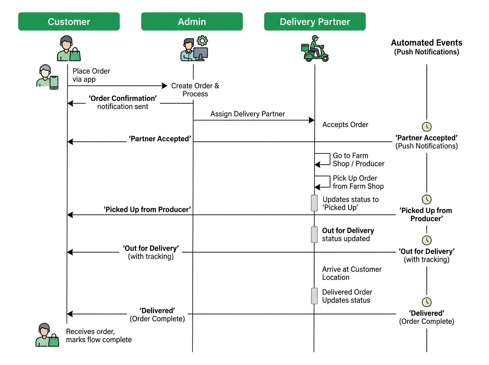
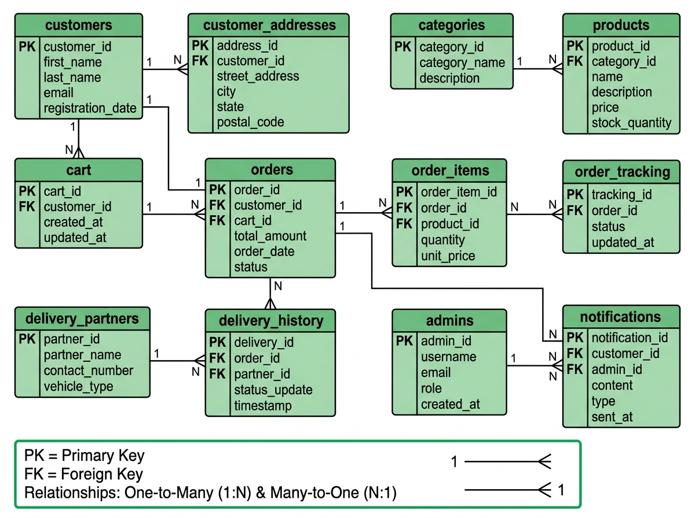

# Farm Products Delivery Platform - Project Documentation

**Prepared by:** Vinothini  
**Tech Stack:** React JS (Vite) + Tailwind CSS | Python FastAPI | MySQL  


---

## Table of Contents
1. [Project Overview](#1-project-overview)
2. [User Roles](#2-user-roles)
3. [Product Categories](#3-product-categories)
4. [System Architecture](#4-system-architecture)
5. [Technology Stack](#5-technology-stack)
6. [Module 1 - Customer Authentication](#6-module-1---customer-authentication)
7. [Module 2 - Customer Home Page & Product Catalog](#7-module-2---customer-home-page--product-catalog)
8. [Module 3 - Product Details & Shopping Cart](#8-module-3---product-details--shopping-cart)
9. [Module 4 - Checkout, Address Management & Orders](#9-module-4---checkout-address-management--orders)
10. [Module 5 - Customer Order Management](#10-module-5---customer-order-management)
11. [Module 6 - Admin Dashboard](#11-module-6---admin-dashboard)
12. [Module 7 - Delivery Partner Management](#12-module-7---delivery-partner-management)
13. [Module 8 - Order Fulfillment & Delivery Tracking](#13-module-8---order-fulfillment--delivery-tracking)
14. [System Flow Diagram](#14-system-flow-diagram)
15. [Entity Relationship (ER) Diagram](#15-entity-relationship-er-diagram)
16. [Project Folder Structure](#16-project-folder-structure)
17. [Module 9 - Reports & Analytics (Planned Flow)](#17-module-9---reports--analytics-planned-flow)
18. [Module 10 - Order Notifications (Planned Flow)](#18-module-10---order-notifications-planned-flow)

---

## 1. Project Overview
The **Farm Products Delivery Platform** is a village-based e-commerce application designed to connect local producers with village customers. The system enables producers to manage inventory and list fresh items, allows customers to order items to their doorsteps, and integrates delivery partners to perform the last-mile fulfillment.

---

## 2. User Roles
| Role                   |          Responsibility                                                                                                                     |
| :--------------------- | :--------------------------------------------------------------------------------------------------------------------------------------- |
| **Admin (Owner)**      | Manages product listings, categories, monitors order lists, assigns delivery partners, and views analytics reports.                       |
| **Customer**           | Browses the local catalog, manages addresses, places orders, and tracks delivery status in real-time.                                    |
| **Delivery Partner**   | Manages assigned orders, updates fulfillment statuses (Accepted, Picked Up, Out for Delivery, Delivered), and views delivery history.     |

---

## 3. Product Categories
* **Milk & Dairy / Goat Farm / Chicken Farm / Eggs**: Fresh farm-produced dairy and poultry products.
* **Fresh Water Fish / Sea Fish / Prawns / Crab**: Freshly caught marine and inland seafood.
* **Meat & Vegetables**: Organic, farm-fresh meat cuts and seasonal vegetables.

---

## 4. System Architecture
* **Frontend Layer**: React 19 (Vite) single-page application (SPA) styled with Tailwind CSS, utilizing Axios for secure, stateless communication.
* **Backend Layer**: FastAPI web server handling validation (Pydantic), ORM mappings (SQLAlchemy), password hashing (bcrypt), and authentication (JWT).
* **Database Layer**: Hosted MySQL instance storing persistent schemas for products, customers, orders, tracking history, and delivery assignments.

---

## 5. Technology Stack
* **Frontend**: React 19, Vite, Tailwind CSS, React Router DOM, Axios.
* **Backend**: Python 3.10+, FastAPI, SQLAlchemy, Pydantic, python-jose, bcrypt.
* **Database**: MySQL 8.4 


---

## 6. Module 1 - Customer Authentication
### 6.1 Objective
Establish secure, stateless customer access using role-scoped JWT tokens, allowing registration, standard login, OTP verification, and password resets.

### 6.2 Features
* **Registration**: Auto-generates unique Customer IDs (`CUS001`, `CUS002`...).
* **Login Modes**: Standard Password login or Mobile Number OTP verification.
* **Security**: Enforces 24-hour expiration JWT tokens stored securely in `localStorage`.

### 6.3 Frontend Structure
* `context/AuthContext.jsx`: Global authentication provider.
* `pages/Login.jsx` & `pages/Register.jsx`: Interfaces with password/OTP toggle.
* `components/ProtectedRoute.jsx`: Intercepts unauthenticated customer paths.

### 6.4 Database Schema
* **`customers`**: `id`, `customer_id`, `full_name`, `mobile_number`, `email`, `village`, `password`, `status`, `created_at`.

---

## 7. Module 2 - Customer Home Page & Product Catalog
### 7.1 Objective
Provide a highly responsive, clean catalog cataloguing categories, featured items, and search functionality.

### 7.2 Features
* Smart Navbar with active segment tracking and live cart badges.
* Live search input resolving matching items on keystroke.
* Local asset fallbacks for missing product images.

### 7.3 Frontend Structure
* `pages/CustomerDashboard.jsx`: Assembles the layout sections.
* `pages/CategoryProducts.jsx`: Filters products by category.
* `components/ProductCard.jsx`: Displays image, price, and instant cart actions.

### 7.4 Database Schema
* **`categories`**: `id`, `category_name`, `category_image`, `status`.

---

## 8. Module 3 - Product Details & Shopping Cart
### 8.1 Objective
Implement a multi-image details gallery and persistent shopping cart matching stock limits.

### 8.2 Features
* Gallery preview switching with stock quantity checks (`min=1`, `max=stock`).
* Real-time cart calculations (subtotal, shipping fees, free shipping over ₹500).

### 8.3 Frontend Structure
* `context/CartContext.jsx`: Manages global cart state and syncs to backend.
* `pages/Cart.jsx`: Item listings, quantity selectors, and totals breakdown.

### 8.4 Database Schema
* **`cart`**: `id`, `customer_id`, `product_id`, `quantity`, `created_at`.
* **`products`**: `id`, `category_id`, `product_name`, `description`, `price`, `stock`, `unit`, `images` (JSON array).

---

## 9. Module 4 - Checkout, Address Management & Orders
### 9.1 Objective
Manage customer addresses, payment selections, and execute secure order placement transactions.

### 9.2 Features
* Address validation: 10-digit mobile number, 6-digit pincode.
* Places orders, clears active cart, and reduces item stock level.

### 9.3 Frontend Structure
* `pages/Checkout.jsx`: Combines address choices, summary cards, and place order button.
* `pages/OrderSuccess.jsx`: Displays checkout confirmation.

### 9.5 Database Schema
* **`customer_addresses`**: `id`, `customer_id`, `full_name`, `mobile_number`, `address`, `village`, `district`, `state`, `pincode`, `is_default`.
* **`orders`**: `order_id`, `customer_id`, `address_id`, `total_amount`, `payment_method`, `order_status`, `created_at`.
* **`order_items`**: `id`, `order_id`, `product_id`, `quantity`, `price`.

---

## 10. Module 5 - Customer Order Management
### 10.1 Objective
Enable customers to track order progress timelines, trigger cancellations, and perform instant reordering.

### 10.2 Features
* Interactive tracking timeline mapping status changes.
* Cancellation available only while order status is `"Pending"`.
* Reorder: Instantly adds all items of a completed order back to the active cart.

### 10.3 Frontend Structure
* `pages/MyOrders.jsx`: Lists customer orders.
* `pages/OrderDetailsPage.jsx`: Details view, tracking steps, cancel and reorder actions.

---

## 11. Module 6 - Admin Dashboard
### 11.1 Objective
Enable administrators to manage categories, inventory, customer lists, and assign orders to delivery partners.

### 11.2 Features
* One-time secure setup process:
  * **Security Controls for First-Time Setup**: The `/api/admin/setup/create-first-admin` endpoint includes a security validation query. Upon invocation, it checks if there are any existing records in the `admins` table. If any administrator exists, the request is immediately rejected with a `403 Forbidden` response. This locks down the initialization route post-deployment and prevents unauthorized accounts from bootstrapping themselves as system administrators.
* Dashboard analytics summary metrics cards.
* CRUD management interfaces for inventory catalogs.

### 11.3 Frontend Structure
* `pages/admin/AdminDashboardHome.jsx`: Display stat panels.
* `pages/admin/AdminProducts.jsx`: Inventory controls.
* `pages/admin/AdminOrders.jsx`: Main order tracking grid.

---

## 12. Module 7 - Delivery Partner Management
### 12.1 Objective
Provide administrators the ability to manage delivery partner accounts and assign orders.

### 12.2 Features
* Interactive partner list and toggle activation status (Enable/Disable).
* Active partner order assignment modal.

### 12.3 Frontend Structure
* `pages/admin/AdminDeliveryManagement.jsx`: Active partner panel.
* `components/admin/AssignOrderModal.jsx`: Assigns orders to partners.

---

## 13. Module 8 - Order Fulfillment & Delivery Tracking
### 13.1 Objective
Establish an integrated workflow syncing admin assignments, partner delivery updates, and customer real-time status tracking.

### 13.2 Features
* Expanded status tracking incorporating `"Picked Up"` state.
* Customer tracking view displays partner name, mobile number, and ETA.
* Backend fallback checks: Fetches partner mobile numbers directly if assignment records are archived.

### 13.3 Frontend Structure
* `components/OrderTrackingTimeline.jsx`: 6-step progress timeline.
* `pages/OrderHistory.jsx`: Lists customer history (Delivered/Cancelled).

### 13.4 Delivery Status Transitions

| Status State        | Triggered By        | Description / Transition Rules                                                  |
| :------------------ | :------------------ | :------------------------------------------------------------------------------ |
| **Pending**         | Customer            | Initial state upon placing an order. Address and inventory stock validated.      |
| **Accepted**        | Admin               | Admin reviews and accepts the order. Stock is locked/deducted.                   |
| **Assigned**        | Admin               | Admin assigns a specific active Delivery Partner to fulfill the shipment.       |
| **Picked Up**       | Delivery Partner    | Partner picks up fresh items from the local Farm Shop and scans code to confirm. |
| **Out for Delivery**| Delivery Partner    | Partner departs from the Farm Shop towards the customer's shipping address.      |
| **Delivered**       | Delivery Partner    | Partner arrives, completes delivery, and marks order as fully complete.          |
| **Cancelled**       | Customer / Admin    | Allowed for customers only while Pending. Admins can cancel up to Assignment.    |

---

## 14. System Flow Diagram

The diagram below details the sequence flow of an order:



---

## 15. Entity Relationship (ER) Diagram

The diagram below details the physical database tables mapping:



---

## 16. Project Folder Structure & Directory Map

The codebase is organized into three principal subfolders: database scripts, backend server, and frontend web client. Below is a map of key entry files and directories:

* **`farm-product-database/`**: Contains the SQL database initialization script:
  * `farm_delivery.sql`: The database schema definition and initial table seed rows.
* **`farm-product-backend/`**: Stores backend logic, schemas, and package definitions:
  * `requirements.txt`: Python package dependencies.
  * `app/`: Source directory for the FastAPI app.
    * `database.py`: SQLAlchemy connection wrapper.
    * `models.py`: Declarative ORM schemas for the 12 MySQL tables.
    * `schemas.py`: Pydantic data schemas defining endpoint request/response bodies.
    * `auth_utils.py`: JWT utilities, token generation, and password encryption helper.
    * `main.py`: Main FastAPI script hosting all API routes.
* **`farm-product-frontend/`**: Stores the React-Vite web application:
  * `package.json`: Frontend npm package configuration and run commands.
  * `vercel.json`: Deployment redirect configs for routing logic.
  * `src/`: Client React source files.
    * `api/`: API client modules utilizing Axios wrappers.
    * `context/`: Shared global context hooks (e.g. `CartContext.jsx`).
    * `components/`: UI components, layout structures, and admin dashboard widgets.
    * `pages/`: Page views for customers, admins, and delivery riders.

---

## 17. Coding Guidelines & Token Storage

### 17.1 Coding Guidelines & Conventions
The project follows standard corporate style guidelines to maintain code readability across layers:
* **Frontend (React)**:
  * Component file naming: PascalCase (e.g. `AdminOrders.jsx`, `OrderTrackingTimeline.jsx`).
  * Variables, functions, and state hooks: camelCase (e.g. `const [isAuthenticated, setIsAuthenticated] = useState(false)`).
  * API services: camelCase modules (e.g. `cartApi.js`).
* **Backend (FastAPI)**:
  * File and directory naming: snake_case (e.g. `auth_utils.py`).
  * Endpoint URLs: kebab-case (e.g. `GET /api/admin/dashboard-summary`).
  * Database models and fields: snake_case matching the MySQL relational fields.

### 17.2 Authentication Token Storage Mechanism
To maintain secure, stateless customer and partner sessions:
* **Token Storage**: On successful register/login, the JWT token returned by the FastAPI server is saved in the browser's `localStorage` (`localStorage.setItem('token', token)`).
* **Axios Interceptor**: The frontend uses a central Axios configuration at `src/api/axios.js` that intercepts every outgoing HTTP request and automatically injects the stored JWT token into the request header:
  ```javascript
  axios.interceptors.request.use((config) => {
    const token = localStorage.getItem('token');
    if (token) {
      config.headers.Authorization = `Bearer ${token}`;
    }
    return config;
  });
  ```

---


---

## 18. Module 9 - Reports & Analytics (Roadmap Deliverables)
### 18.1 Objective
Provide administrators with business analytics to track sales, popular items, delivery partner performance metrics, and order fulfillment times.

### 18.2 Proposed Features
* **Sales Analytics**: Revenue curves over time (daily, weekly, monthly views).
* **Product Insights**: Bar charts displaying top 5 selling items and popular categories.
* **Delivery Performance**: Partner stats tracking average delivery duration.

### 18.3 Target Frontend Structure
* `pages/admin/AdminReports.jsx`: Displays charts using Recharts or Chart.js libraries.
* `components/admin/ReportSelector.jsx`: Date range filters and export options.

### 18.4 Proposed Database Schema
* **`analytics_snapshots`**: `id` (PK), `snapshot_date` (Date), `total_revenue` (Decimal), `orders_count` (Integer), `popular_category_id` (FK to categories), `created_at` (Timestamp).

---

## 19. Module 10 - Order Notifications (Upcoming Phase Features)
### 19.1 Objective
Implement real-time push, email, or SMS alerts informing customers and delivery partners of order state transitions.

### 19.2 Proposed Features
* Automated notification triggers when order status changes (Accepted, Picked Up, Out for Delivery, Delivered).
* Customer in-app notification bell icon displaying active alert lists.
* Read/Unread message states.

### 19.3 Target Frontend Structure
* `components/NotificationDropdown.jsx`: Floating notification overlay in header.
* `context/NotificationContext.jsx`: WebSocket or long-polling notification state sync.

### 19.4 Proposed Database Schema
* **`notifications`**: `id`, `customer_id` (FK), `order_id` (FK), `title`, `message`, `status` (unread/read), `sent_at`.


